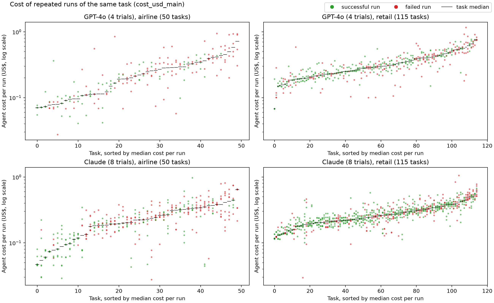
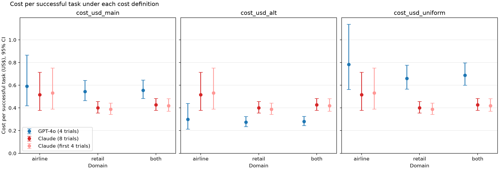
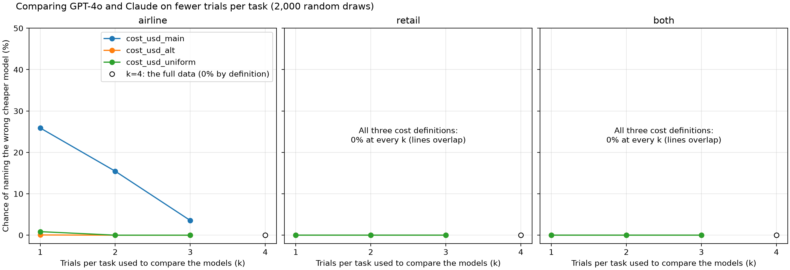

# tau-bench re-analysis: results

Generated by `analyze.py` from `results/runs.csv`. Random seed 20261117, 2,000
bootstrap resamples and 2,000 draws per simulation. See `../README.md` for how
the costs were estimated and their limitations.

## Two ideas used below

- **Coefficient of variation (CV):** the standard deviation of a task's run costs divided
  by their mean. A CV of 0.3 means a run typically costs about 30% more or less than that
  task's average run. Because it is relative, cheap and expensive tasks can be compared.
- **Bootstrap confidence interval:** we resample tasks with replacement 2,000 times
  (keeping each task's trials together, since runs of the same task are alike), recompute
  the number each time, and report the middle 95% of the results. It shows how much the
  number could move if tau-bench had contained a different mix of similar tasks.

## Cost definitions

- **main**: `cost_usd_main`: each provider's documented tool counting; GPT-4o at 2024-05-13 prices
- **alt**: `cost_usd_alt`: as main, but GPT-4o at 2024-08-06 prices (Claude unchanged)
- **uniform**: `cost_usd_uniform`: tool list counted the same way (JSON) for both models

Questions 1 and 2 look within one model and use `main`. Questions 3 and 4 compare models
and use all three.

## 1. How much does cost vary across repeats of the same task?

Per task: CV and max/min ratio of run cost across trials; then the median (p50) and 90th
percentile (p90) across tasks. Models should be compared on the 4-trial views: with 8
trials there are more chances to draw an extreme run, so max/min grows by construction.

| view | domain | tasks | CV p50 | CV p90 | max/min p50 | max/min p90 | worst task |
|---|---|---|---|---|---|---|---|
| GPT-4o (4 trials) | airline | 50 | 0.32 | 0.63 | 2.03x | 5.30x | 6.8x |
| GPT-4o (4 trials) | retail | 115 | 0.15 | 0.38 | 1.40x | 2.60x | 5.2x |
| Claude (8 trials) | airline | 50 | 0.29 | 0.59 | 2.29x | 6.32x | 15.5x |
| Claude (8 trials) | retail | 115 | 0.14 | 0.32 | 1.50x | 2.53x | 6.5x |
| Claude (first 4 trials) | airline | 50 | 0.27 | 0.58 | 1.81x | 4.41x | 15.5x |
| Claude (first 4 trials) | retail | 115 | 0.11 | 0.30 | 1.27x | 2.03x | 3.8x |

- With 4 trials, the costliest run of a typical task costs
  **1.27x to 2.03x**
  the cheapest (median max/min across tasks), and
  **2.03x to 5.30x**
  for the 10% most variable tasks.
- The most extreme task: **15.5x** (Claude (8 trials), airline).
- Airline costs vary more than retail for every view (higher median CV).

## 2. Do failed runs cost more than successful ones?

**Overall** (all runs pooled):

| view | domain | successful runs | failed runs | median cost, successful | median cost, failed | failed / successful |
|---|---|---|---|---|---|---|
| GPT-4o (4 trials) | airline | 84 | 116 | $0.133 | $0.256 | 1.92x |
| GPT-4o (4 trials) | retail | 278 | 182 | $0.274 | $0.317 | 1.16x |
| Claude (8 trials) | airline | 184 | 216 | $0.145 | $0.259 | 1.78x |
| Claude (8 trials) | retail | 637 | 283 | $0.239 | $0.285 | 1.19x |

**Within the same task** (only tasks with both successful and failed runs):

| view | domain | tasks with both outcomes | median per-task ratio (failed / successful) | middle 50% of tasks | tasks where failures cost more |
|---|---|---|---|---|---|
| GPT-4o (4 trials) | airline | 26 of 50 | 0.89x | 0.75x to 1.46x | 42% |
| GPT-4o (4 trials) | retail | 49 of 115 | 0.86x | 0.68x to 1.03x | 31% |
| Claude (8 trials) | airline | 32 of 50 | 1.14x | 0.88x to 1.49x | 62% |
| Claude (8 trials) | retail | 67 of 115 | 0.96x | 0.81x to 1.09x | 42% |

- Pooled, failed runs cost **1.16x to 1.92x**
  as much as successful ones.
- Within the same task, the median ratio is only
  **0.86x to 1.14x**. Much of the pooled gap comes from failures being concentrated in harder, longer tasks, not from failing itself.

## 3. Cost per successful task

Total cost of all runs (failed ones included) divided by the number of successes, with
95% bootstrap confidence intervals (resampling tasks).

| view | domain | main | alt | uniform |
|---|---|---|---|---|
| GPT-4o (4 trials) | airline | $0.591 [$0.420, $0.866] | $0.300 [$0.213, $0.439] | $0.783 [$0.563, $1.138] |
| GPT-4o (4 trials) | retail | $0.544 [$0.465, $0.642] | $0.275 [$0.235, $0.324] | $0.659 [$0.566, $0.776] |
| GPT-4o (4 trials) | both | $0.555 [$0.483, $0.645] | $0.280 [$0.244, $0.326] | $0.688 [$0.600, $0.798] |
| Claude (8 trials) | airline | $0.516 [$0.378, $0.714] | $0.516 [$0.378, $0.714] | $0.516 [$0.378, $0.714] |
| Claude (8 trials) | retail | $0.401 [$0.355, $0.456] | $0.401 [$0.355, $0.456] | $0.401 [$0.355, $0.456] |
| Claude (8 trials) | both | $0.427 [$0.378, $0.483] | $0.427 [$0.378, $0.483] | $0.427 [$0.378, $0.483] |
| Claude (first 4 trials) | airline | $0.532 [$0.390, $0.752] | $0.532 [$0.390, $0.752] | $0.532 [$0.390, $0.752] |
| Claude (first 4 trials) | retail | $0.389 [$0.343, $0.443] | $0.389 [$0.343, $0.443] | $0.389 [$0.343, $0.443] |
| Claude (first 4 trials) | both | $0.420 [$0.372, $0.481] | $0.420 [$0.372, $0.481] | $0.420 [$0.372, $0.481] |

**Paired comparison:** GPT-4o's cost per success divided by Claude's, on the same tasks
(GPT-4o's 4 trials vs Claude's first 4), resampling tasks together for both models.
Below 1.0 means GPT-4o is cheaper per success; above 1.0, Claude.

| domain | main | alt | uniform |
|---|---|---|---|
| airline | 1.11 [0.85, 1.44] (includes 1.0) | 0.56 [0.43, 0.73] (excludes 1.0) | 1.47 [1.14, 1.90] (excludes 1.0) |
| retail | 1.40 [1.26, 1.55] (excludes 1.0) | 0.71 [0.64, 0.78] (excludes 1.0) | 1.70 [1.53, 1.87] (excludes 1.0) |
| both | 1.32 [1.19, 1.46] (excludes 1.0) | 0.67 [0.60, 0.74] (excludes 1.0) | 1.64 [1.48, 1.80] (excludes 1.0) |

## 4. How often does comparing on fewer trials pick the wrong cheaper model?

For k trials per task (picked at random, without replacement, 2,000 times), how often
does the GPT-4o vs Claude comparison reach the opposite conclusion from all 4 trials?
k = 4 is the full data itself, so its flip chance is 0% by definition.

| domain | cost definition | GPT-4o / Claude, all 4 trials | flip chance, k=1 | flip chance, k=2 | flip chance, k=3 |
|---|---|---|---|---|---|
| airline | main | 1.11 (Claude cheaper) | 25.9% | 15.4% | 3.5% |
| airline | alt | 0.56 (GPT-4o cheaper) | 0.1% | 0.0% | 0.0% |
| airline | uniform | 1.47 (Claude cheaper) | 0.9% | 0.0% | 0.0% |
| retail | main | 1.40 (Claude cheaper) | 0.0% | 0.0% | 0.0% |
| retail | alt | 0.71 (GPT-4o cheaper) | 0.0% | 0.0% | 0.0% |
| retail | uniform | 1.70 (Claude cheaper) | 0.0% | 0.0% | 0.0% |
| both | main | 1.32 (Claude cheaper) | 0.0% | 0.0% | 0.0% |
| both | alt | 0.67 (GPT-4o cheaper) | 0.0% | 0.0% | 0.0% |
| both | uniform | 1.64 (Claude cheaper) | 0.0% | 0.0% | 0.0% |

- The largest risk is **25.9% at k=1**
  (airline, `main`), where the full-data ratio is
  1.11, close to 1.0. Where the models differ clearly, a
  single trial per task almost never flips the answer.
- This measures only trial-to-trial noise for this fixed set of tasks, not the
  uncertainty from the cost assumptions themselves (see below).

## What holds under all three cost definitions

- airline: cheaper per success is Claude under `main` (CI includes 1.0: not distinguishable), GPT-4o under `alt`, Claude under `uniform`. The conclusion **depends on the assumption**.
- retail: cheaper per success is Claude under `main`, GPT-4o under `alt`, Claude under `uniform`. The conclusion **depends on the assumption**.
- both: cheaper per success is Claude under `main`, GPT-4o under `alt`, Claude under `uniform`. The conclusion **depends on the assumption**.

Within-model findings (questions 1 and 2) do not depend on the cost definition in the
same way: each definition adds a fixed amount per call to every run of a model.
